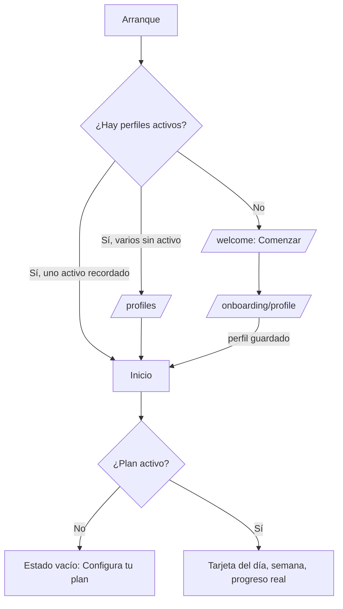
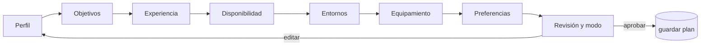
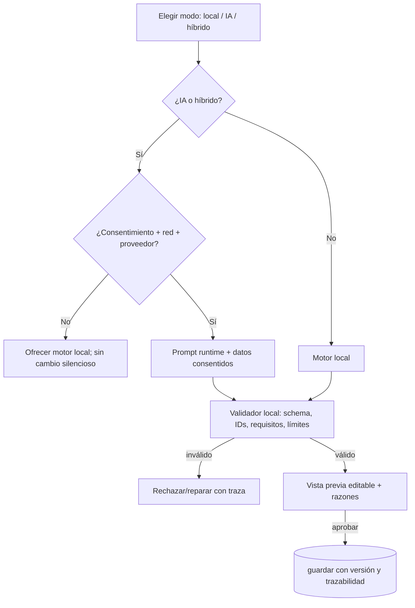
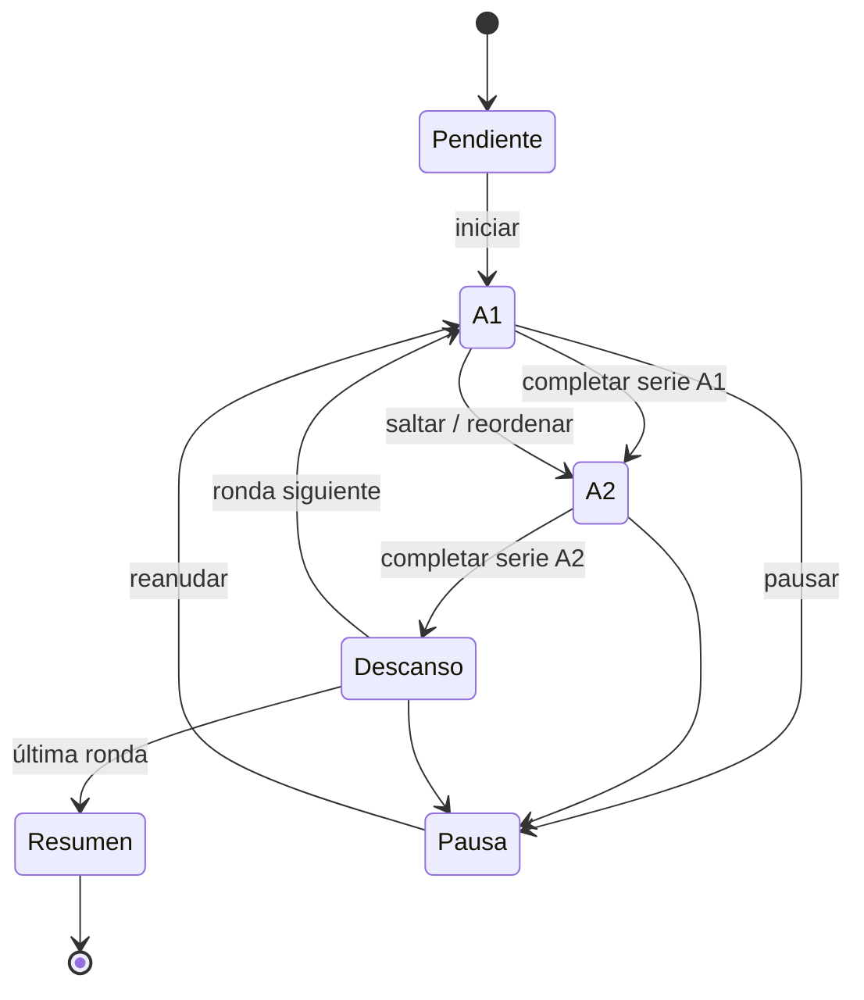

# ForgeFit — AppFlow

Referencias de pantalla: ver `UI-UX-Brief.md`. Los ejemplos de las capturas no son valores por defecto.

## 1. Mapa de rutas (expo-router)
```
/                     → redirige según estado
/welcome              bienvenida (sin perfiles)
/profiles             selector de perfiles
/onboarding/[step]    etapas 1–8 (profile, goals, experience, availability, environments, equipment, preferences, review)
/(tabs)/index         Inicio
/(tabs)/routines      Rutinas (plan/calendario)
/(tabs)/exercises     Ejercicios (biblioteca)
/(tabs)/progress      Progreso / Rendimiento
/(tabs)/more          Más (perfiles, entornos, reloj, datos, ajustes)
/exercise/[id]        detalle · /exercise/[id]/anatomy
/session/[id]         entrenamiento activo · /session/[id]/rest
/plan/proposal        propuesta editable · /plan/mode (local/IA/híbrido)
/equipment/...        catálogo, ficha, inventario por entorno
/watch                conectar reloj (incremento separado)
```

## 2. Arranque

Reglas: primera ejecución = 0 perfiles; nunca se preselecciona opción alguna; el perfil activo solo se recuerda tras elegirlo el usuario.

## 3. Onboarding (8 etapas, pausable)

Cada etapa: Volver, Guardar progreso (borrador por perfil), Omitir (opcionales), validación Zod con errores accesibles. Solo alias es imprescindible. Plan no se genera hasta haber objetivo y disponibilidad suficientes; alternativa «crear manualmente».

## 4. Generación de plan


## 5. Sesión activa y biseries

Cada transición se persiste (evento + marcas de tiempo). Cierre accidental ⇒ al reabrir se ofrece reanudar. Corrección de serie permitida con traza. Ejercicio individual = bloque con un solo miembro.

## 6. Calendario y rachas
Estados de `scheduled_sessions`: programada, completada, pendiente, omitida, reprogramada; días: descanso planificado, descanso extraordinario. Racha semanal: semana cumplida si todas las sesiones vencidas están realizadas o válidamente reprogramadas; descansos neutros; semana sin sesiones pausa; reprogramaciones auditadas en `session_reschedules`. Mensajes sin culpa.

## 7. Reloj (incremento separado)
Estados: no compatible · detectado · permisos pendientes · conectado · sincronizando · desconectado. El móvil funciona íntegro sin reloj. El perfil activo es el único cuyos datos llegan al reloj vinculado.

## 8. Estados transversales
Vacío, carga (skeleton), error recuperable, sin conexión (IA), permisos revocados (salud) con texto accesible alternativo a todo visual (3D, gráficos).
